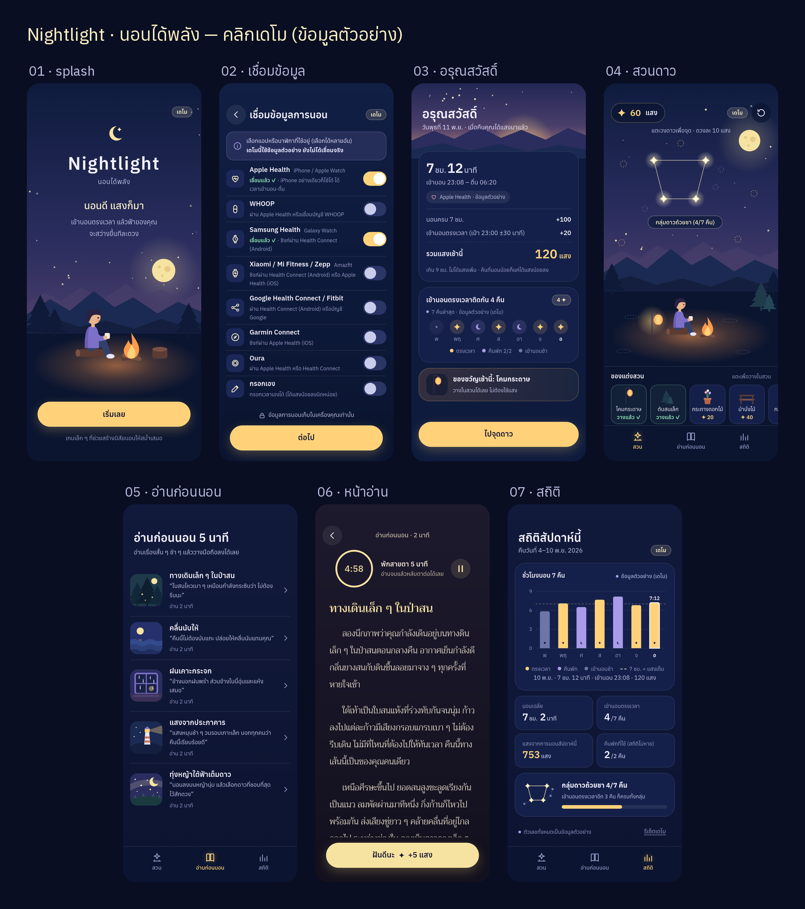

# Nightlight · นอนได้พลัง — คลิกเดโม

เดโมคลิกได้ของไอเดียเกม "นอนได้พลัง" (ชื่อชั่วคราว Project Nightlight)
การนอนเมื่อคืนกลายเป็น **แสง** แล้วเอาแสงไปจุดดาวและแต่งสวนบนฟ้ารอบตัวละคร
เข้านอนตรงเวลาติดกันหลายคืน ดาวก็ต่อกันเป็นกลุ่มดาว

> **ข้อมูลทั้งหมดเป็นข้อมูลตัวอย่าง** ยังไม่ได้เชื่อม Apple Health หรือนาฬิกาเรือนไหนจริง

## วิธีเปิด
```bash
cd nightlight-demo
python3 -m http.server 8000
```
แล้วเปิด http://localhost:8000 (ออกแบบสำหรับจอมือถือ 390×844 ถ้าเปิดบนคอมจะแสดงเป็นกรอบมือถือกลางจอ)
ไม่ต้อง build และไม่ต้องต่อเน็ต ฟอนต์อยู่ในโฟลเดอร์ `assets/fonts/` แล้ว

## หน้าจอ
| URL | หน้า |
|---|---|
| `#splash` | หน้าแรก ฉากกลางคืนกับกองไฟ |
| `#connect` | เชื่อมข้อมูลการนอน (จำลอง) |
| `#morning` | อรุณสวัสดิ์ สรุปแสงเมื่อคืน (7 ชม. 12 นาที → 120 แสง) |
| `#garden` | สวนดาว จุดดาว แต่งสวน |
| `#read` | อ่านก่อนนอน 5 นาที (5 เรื่อง) |
| `#reader/<id>` | หน้าอ่าน + ตัวจับเวลา 5 นาที (`forest`, `waves`, `rain`, `lighthouse`, `stars`) |
| `#stats` | สถิติสัปดาห์ |

ความคืบหน้า (แสงคงเหลือ ดาวที่จุด ของที่วาง) เก็บใน localStorage กด "รีเซ็ตเดโม" ได้ที่หน้าสวน (ปุ่มลูกศรวน) หรือท้ายหน้าสถิติ

## โครงไฟล์
- `index.html`, `css/style.css`
- `js/app.js` ตัวเปลี่ยนหน้าและ logic, `js/scene.js` ภาพ SVG ทั้งหมด, `js/content.js` เรื่องอ่านก่อนนอนและข้อมูลการนอนตัวอย่าง
- `assets/fonts/` Anuphan และ Trirong (OFL)
- `tools/screenshot.py` ถ่ายภาพหน้าจอทั้ง 7 หน้าไปไว้ที่ `../demo-screens/` (`python3 tools/screenshot.py`)

## การเชื่อมข้อมูลจริง (สรุปเทคนิค)
ดู docs/wearables.md

## เรฟ mood & tone
ดู docs/refs.md

## ภาพหน้าจอ

